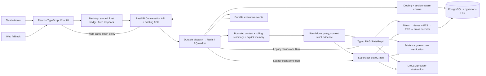
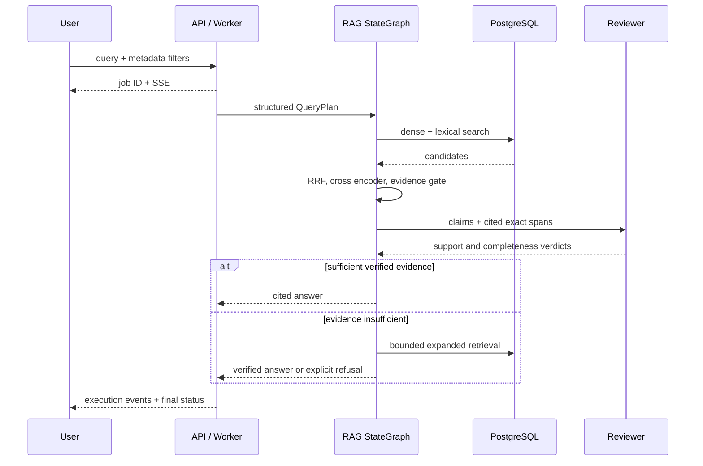
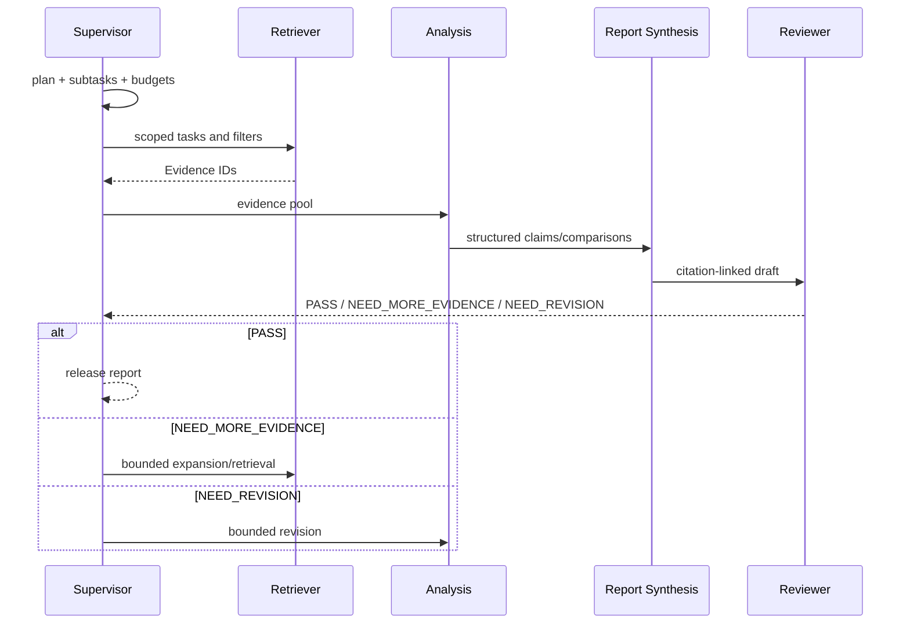

# Scientific RAGAgent

**English | [简体中文](README.zh-CN.md)**

A local scientific literature assistant with persistent RAG/Research chats,
inspectable conversation memory and a Tauri desktop entry. It retains the existing
evidence-grounded knowledge base and Supervisor workflows. MIT licensed; paper and model-weight licenses remain
independent. No langgraph-supervisor dependency. No fabricated benchmark claims.

The default source branch is
[`main`](https://github.com/maczhouyi-del/RAGSystem/tree/main).
This copy retains the original commit history and MIT license. The
[original repository](https://github.com/chouytong/RAGAgent) is preserved;
the migration starts from its `fix/engineering-hardening` commit `df75bdd`.
Historical CI and installer evidence links still refer to runs in that repository.

## Download, install and first use

Download **[v0.2.0-beta.2 from GitHub Releases](https://github.com/maczhouyi-del/RAGSystem/releases/tag/v0.2.0-beta.2)**.
The application version is **0.2.0**. This beta includes the Windows graphical deployment assistant and first-model wizard;
previous beta1 retains its console assistant. Use the client and deployment ZIP from the same Release.

**Install both the desktop client and its backend.** The desktop installer contains the client. The deployment assistant
uses Docker to start PostgreSQL/pgvector, Redis, API, three workers and Web. Packaged users need no host Python, Node.js,
Rust or Git and do not edit `.env`, run Compose commands or edit Agent YAML. **Docker and Internet access for initial downloads remain required.**

### 1. Download matching files

| Platform | Desktop installer (choose one) | Required deployment ZIP |
| --- | --- | --- |
| Windows 11 x64 | MSI or installer EXE | `RAGSystem-deployment-windows-x86_64.zip` |
| macOS Apple Silicon | aarch64 DMG | `RAGSystem-deployment-macos-aarch64.zip` |
| macOS Intel | x64 DMG | `RAGSystem-deployment-macos-x86_64.zip` |
| Linux x64 (Ubuntu 24.04) | deb or AppImage | `RAGSystem-deployment-linux-x86_64.zip` |

Expand **Assets** on the Release and download both files, `SHA256SUMS.txt` and `release-manifest.json`.
Public Release assets do not require Actions Artifact login or depend on its retention period.
The manifest records the actual source SHA, version, platform, size and SHA256. Installer filename spaces become underscores; bytes remain unchanged.
Compare hashes; Windows PowerShell supports `Get-FileHash file-path -Algorithm SHA256`.
`installation-guides.zip` contains both READMEs, detailed guides, evidence and third-party licenses for offline reading.

Recommended: **16 GB RAM and at least 20 GB free disk**, with extra space for papers/models.
The assistant checks at least 5 GiB on the deployment drive; also check Docker's virtual disk.
Initial backend construction normally takes 10–30 minutes depending on your network/computer.
Packages are unsigned and not macOS-notarized. Verify their source/hashes and follow OS/organisation policy; do not disable security protections.

### 2. Install on Windows 11

1. Follow the [official Docker Windows guide](https://docs.docker.com/desktop/setup/install/windows-install/).
   Complete required administrator actions, WSL2/virtualisation setup and reboots. Check Docker licensing/subscription terms.
   Open Docker Desktop, wait until ready and use **Linux containers**. A working Hyper-V/Linux Docker setup need not switch to WSL.
2. Double-click the MSI or installer EXE to install **Scientific RAGAgent**. Install missing WebView2 using installer/Microsoft guidance.
3. Unpack the deployment ZIP's complete `RAGSystem` folder into a permanent private writable location,
   such as `C:\Users\your-name\RAGSystem`. Avoid Program Files, shared drives and temporary caches; retain hidden files.
4. Open the desktop client and double-click **`RAGSystem-Setup.exe`** in that folder. Windows opens the five-step graphical wizard.

### 3. Complete the five deployment steps

1. **Check prerequisites**: check Docker/WSL when applicable, container mode, Compose, disk and ports.
   Follow the explanation and check again after repair. The assistant does not install Docker or kill conflicting processes.
2. **Pair local authorization**: open the desktop's Connection authorization panel, copy its pairing hash and save it in the assistant.
   Copy manually if clipboard access fails. This is not your model API key; the desktop bearer stays in Windows Credential Manager.
   Keep existing pairing unless explicitly replacing it.
3. **Save a private key**: select OpenAI, DeepSeek or Anthropic and enter your key in the masked native field.
   Saving clears the field and exposes presence only. Existing keys require replacement confirmation; local/later configuration can skip.
   For OpenAI-compatible services choose OpenAI in the assistant (`OPENAI_API_KEY`).
4. **Start/recover the system**: acknowledge that startup may resume existing queued jobs and their previously authorised costs.
   The assistant starts the database/Redis, applies migrations, starts API/three workers/Web and checks readiness.
   Keep the window open during initial construction. Retry after following a safe error message; never reset data to recover startup.
5. **Begin using the desktop**: connect and check authorization, then follow the first-use progress and Next button.
   Infrastructure readiness does not prove model inference. A new installation does not automatically submit model tests.

On later launches start Docker and use the assistant's **existing configuration/start/recover** shortcut.
Pairing and private keys need not be entered again.

### 4. Configure your first model

1. Open **Settings → first-model configuration** and choose a provider, an account-accessible chat model and any required API base.
   Preset names are suggestions, not entitlement checks. Do not enter API keys into this desktop/web form.
2. Save and explicitly confirm the same default model for Supervisor, Retriever, Analyst and Reviewer.
   Advanced settings retain independent role editing. Existing mappings are read first and never overwritten automatically;
   the shortcut does not change embedding/reranker or old vector indexes.
3. After saving a key in the native assistant, start/recover to reload it into containers, then refresh configuration/key presence.
   Refresh does not test models.
4. Choose directory connection or actual inference testing and confirm its content/cost notice before sending any request.
   Directory tests generate no answer. Inference tests send a fixed instruction, not papers/chats, and may incur fees.
   Failures never automatically retry paid requests; reopening settings never tests automatically.

| State | What it proves |
| --- | --- |
| Configuration saved | Server saved role/provider/model mapping, not account availability |
| Key present | Private runtime variable exists, not key validity; local models may need no key |
| Connection succeeded | Model directory responds, not successful inference |
| Actual inference passed | This fixed instruction passed, not scientific answer quality |

Some compatible services lack a model directory. You may explicitly confirm a separate inference test.
Replace rejected keys in the native assistant and start to reload them; change unavailable model names/providers in Settings.
Test advanced roles separately when they use different models.
Ollama needs separate installation/model loading. Docker Desktop may access the host at `http://host.docker.internal:11434`;
container `localhost` refers to the container. Linux host routing needs separate setup. Do not expose models/databases publicly.

### 5. Import your first paper and ask a question

1. Follow Next to **Knowledge Base** and upload a PDF you are entitled to use.
2. Watch parsing/indexing and wait for **indexed**. Default local embedding/reranker weights download on first use.
   Repair network/disk/cache issues and retry without deleting volumes or mixing index dimensions.
3. Ask in **RAG**, or choose **Research**. Real calls may cost money; inspect citations, paper locations and evidence.
4. Export reports from results. Reopen and connect to the same local system to retrieve papers and chat history.

### 6. macOS, Linux and Web

On macOS choose matching CPU DMG/ZIP and follow the [Docker macOS guide](https://docs.docker.com/desktop/setup/install/mac-install/).
Linux x64 needs Docker Engine + Compose ≥2.24, its desktop WebView/Secret Service prerequisites, and deb or AppImage installation;
AppImage may require distribution-specific FUSE compatibility. Follow local policy for unsigned/notarized-app warnings.

Unpack into a permanent private writable folder and run the native `./RAGSystem-Setup` there (no host Python required).
macOS/Linux retain console menus: **2 Pair and start** with the desktop hash, **5 hidden API-key input**, then **3 Start** to reload keys.
Use the same model wizard and PDF/question flow. Windows GUI support does not establish GUI support on these platforms.

Web remains at `http://127.0.0.1:8080`. Use **9 Web pairing** in the console helper to set a separate credential, then authorize Web.
On Windows open a terminal in the deployment folder and run `.\RAGSystem-Setup.exe --console` for these menus.
Web authentication remains required; a model API key is not a pairing credential.

### 7. Recover from common failures

| Problem | Next action |
| --- | --- |
| Docker missing/stopped | Install/open Docker, wait for readiness, check again |
| WSL/container mode | Follow official virtualisation/WSL/reboot instructions; switch to Linux containers |
| Ports 8000/8080 occupied | Stop only a conflicting application you own; the assistant does not kill processes or connect to unfamiliar APIs |
| Low disk/download failure | Check both deployment drive and Docker virtual disk plus approved network/proxy settings; retain volumes and TLS verification |
| API/database/worker unavailable | Inspect Diagnostics/safe helper error codes, repair Docker service and start/recover without resetting data |
| Key rejected/model unavailable | Replace key in native helper and start, or change model in Settings; refresh and explicitly confirm a new test |
| Model loading/PDF indexing fails | Check model source, cache permissions, space and PDF encryption/corruption; scanned PDFs may require OCR/layout models |

Report only version, build SHA, safe error codes and redacted symptoms, not keys/private env/raw Docker/provider logs or paper contents.
See [troubleshooting](docs/installation/troubleshooting.md) for detail.

### 8. Stop, back up, upgrade and uninstall

Closing the desktop keeps the backend running. Stop through the GUI or console **4 Stop**; data remains.
Five Docker named-volume categories store papers, vectors/metadata/chats, configuration, queues and model cache.
OS vaults hold pairing credentials; `.env` and `.runtime-secrets.env` remain in the original deployment folder.
Keys stay private and do not enter frontend storage, reports or backups.

- **Back up** after all imports/questions/Research finish using **6 Backup**, retaining its complete manifest.
  Backups include database/PDF/nonsecret settings, not keys/queue/model weights; protect private scientific data.
- **Upgrade** only after backup. Unpack a new ZIP into a temporary folder, verify it, then update program files in the original folder.
  Preserve private env files, project name and all five volumes. **7 Upgrade** builds/migrates only after a successful backup;
  failure retains data, without automatic DB downgrade. DB major-version upgrades need separate planning.
- **Uninstall**: the desktop uninstaller removes the client. **8 Uninstall containers** requires explicit `KEEP DATA` and retains volumes/private files.
  Reinstall using the same project to recover history. Do not use Docker Delete volumes/Clean/Purge to repair an installation.
- **Restore on another computer** only into a separate empty environment from your own complete backup; re-pair and re-enter keys.
  See [data, backup, upgrade, restore and uninstall](docs/installation/data-and-upgrades.md).

### Verification scope

See [installation engineering evidence](docs/installation/first-use-evidence.json).
Automated engineering uses **MOCK models**, real PostgreSQL/Redis and Docling Native PDF parsing.
**Human Windows11/macOS/Linux installation and real user models/weight downloads are NOT EXECUTED; scientific quality is NOT MEASURED.**
Windows/Linux ARM64 and other Linux distributions are unverified. No Research-over-RAG superiority is assumed.
Complete the [Windows11 manual checklist](docs/installation/windows-11-checklist.md) and reuse
[existing local scientific evaluation tools](docs/installation/local-evaluation.md) with your own approved papers/models.

## Developer source setup

The following commands are for contributors with Git, Node.js/npm, Rust and platform WebView development dependencies.
Ordinary users should use the packaged beta above. Preserve an existing runtime `.env`.

```bash
git clone --branch main https://github.com/maczhouyi-del/RAGSystem.git
cd RAGSystem
# First checkout only; preserve an existing runtime .env.
cp .env.example .env
npm --prefix frontend ci
npm --prefix frontend run desktop:dev
# Copy Desktop's nonsecret pairing hash into LOCAL_AUTH_TOKEN_HASH in .env.
# Start Compose in another terminal and reconnect Desktop.
docker compose up --build
```

Developer diagnostics: `./scripts/diagnose.sh` (Linux) or
`powershell -NoProfile -File .\scripts\diagnose.ps1` (Windows).
[Read-only diagnostics](docs/environment-diagnostics.md), [deployment](docs/deployment.md)
and the [first-use guide](docs/first-use.md) describe advanced setup.
`/api/health` reports process liveness; `/api/ready` checks DB, Redis and the interactive worker,
without asserting model/provider inference readiness. API docs are at `http://127.0.0.1:8000/docs`;
protected requests require local authorization.

RAG/Research conversation turns use the `interactive` queue; PDF/arXiv use
`ingestion`; benchmarks use `evaluation`. Compose starts one dedicated worker
per queue. `/api/ready` gates DB, Redis and interactive worker availability;
`/api/queues` reports availability and pending counts for all three workloads.
See [deployment](docs/deployment.md#dedicated-workload-queues) for scaling and
migration of already queued jobs.

## Architecture



Python 3.11+, Pydantic v2, SQLAlchemy 2, Alembic, current LangGraph, LiteLLM,
Docling, PostgreSQL/pgvector, Redis/RQ; React/TypeScript/Vite; uv/npm locks,
Docker Compose, pytest/Ruff/mypy and GitHub Actions.

## Chats and local memory

RAG Chat and Research Chat have separate conversation histories, automatic titles,
rename/delete controls, ordered messages, Markdown/code blocks, citations and
collapsible execution details. Research retains Supervisor Plan, agent trace,
Reviewer Result and limitations. Reloading the Web UI or restarting the desktop
reads conversations and messages from PostgreSQL; browser `localStorage` is not
the conversation store. A URL fragment identifies the selected conversation.

The UI initially reads the latest 50 lightweight messages and loads older history
on request. SSE drives live progress; reconnect/resume reconciles new messages and
active placeholders. Run, trace and evidence details load when opened, rather than
with every history refresh. Superseded retry attempts remain audit records and
leave the context used for subsequent questions.

Each turn creates messages and an existing Run/durable dispatch intent together.
The worker persists the released assistant answer with the terminal Run/event;
SSE reconnects replay persisted execution events. Duplicate submissions use a
client UUID; retry creates a new Run and keeps the previous failure visible.
One conversation executes one turn at a time; different conversations remain
independent. Cancellation revokes publication permission and makes a best-effort
queue stop; an already dispatched provider call may still complete or incur cost.

Follow-ups pass through a Context Builder: current question, bounded recent
messages, a deterministic rolling extractive summary and explicitly added memories
resolve pronouns/named candidates into a standalone question. The original and
contextualized query are inspectable in execution details. Older excerpts may
lose information; ambiguous references fail explicitly instead of guessing.
`CONVERSATION_CONTEXT_TOKEN_BUDGET=8192` uses a multilingual approximate token estimate with UTF-8 excerpt caps
for contextualization input; this is not a provider tokenizer or a total workflow budget.
Independent questions skip the rewrite model. Context-dependent questions use selected
Top-K memory text; all structured hard filters still apply. A typed, source-linked
conversation intent/entity state survives restart beside the extractive summary.
The Memory panel exposes this state; changing memory invalidates it.

**Memory ≠ Evidence.** Messages, summaries and memories only guide intent and
retrieval. Both independent graphs retrieve fresh source evidence and retain the
existing evidence gate and claim/citation validation. A historical claim such as
“Dataset A has 500 participants” cannot itself support the next scientific answer.
Structured constraints with metadata filters intersect the current filters;
conflicts fail explicitly. Natural-language preference text alone is not a hard
SQL filter. Add, inspect or delete memory in the conversation's Memory panel;
there is no automatic hidden user profile or external memory service.

Clear Conversation Memory deletes summary/memory records and retains messages;
retained history can create a new summary on a later turn. Clear Conversation
deletes messages, associated Runs/events/dispatch records and memory while keeping
the empty conversation. Delete Conversation removes those records and the
conversation itself. Knowledge-base papers and unrelated evaluation artifacts
are retained. See [conversation/memory lifecycle](docs/conversation-memory.md).

## Local data and remote inference

With the default local Compose services, PDFs/parse files, vector indexes,
conversation history, summaries, structured memory and execution history remain
in local PostgreSQL or named filesystem volumes. There is no cloud conversation
database or SaaS memory storage. Backups, downloaded evaluation artifacts and the
desktop's cached documents are separate copies and need separate deletion.

Remote chat providers receive the necessary questions, conversation context for
rewrite and retrieved excerpts for analysis/review; hosted embedding providers
receive indexed text/search queries. Remote evaluation judges receive answer and
evidence payloads. Local persistence therefore does **not** mean all data stays
on the machine during inference. Configure local chat, embedding, reranker and
parser resources to keep inference local; initial model downloads still require
network unless cached. API keys stay in runtime environment/secrets. Recognizable
credential patterns are rejected from conversation fields; avoid pasting secrets
into free text, since pattern detection cannot identify every possible credential.

## Paper ingestion and knowledge base

Upload PDFs with optional title/authors/year/venue or import an open arXiv ID.
The original PDF, structured sections, text/tables/captions, pages, chunks and
embeddings are retained. Inspect indexing status and metadata in Knowledge Base.
Chunking stays within section and element type, with configurable token target
and overlap. Decimal/scientific-notation values stay intact; recognized Markdown
tables split at row boundaries with separately sourced headers/captions, while
formulas and tables with unknown structure remain atomic even above the target.
New arXiv imports freeze the official versioned ID before downloading. Source
status starts as `unknown`; manually marked withdrawn/retracted papers are
excluded from retrieval. Dense/lexical retrieval share all metadata predicates. Annotate
chunk entities for dataset/method/metric filters through the API.

```bash
curl -F 'file=@paper.pdf' -F 'title=Paper title' -F 'authors=Alice;Bob' \
  http://localhost:8000/api/papers/upload
curl -H 'Content-Type: application/json' -d '{"arxiv_id":"2408.09869"}' \
  http://localhost:8000/api/papers/arxiv
```

## RAG and research

RAG handles fact queries, method comparison and constrained retrieval. Every
released factual claim has validated structured Evidence IDs, exact supporting
text, paper, section, page and chunk. Model-authored citation markers are rejected;
only deterministic formatting emits citations. The reviewer must also support
every attached claim/evidence pair; an unrelated citation requires revision.
Multi-query retrieval reranks against the original question or current subtask,
preserving that target during expansion. The configured rerank threshold
restricts the evidence supplied to generation and verification in both workflows.
Missing support triggers bounded expansion then explicit refusal.
Retrieval scores are heuristics, not calibrated model confidence probabilities.



Research generates a structured plan/subtasks, invokes Retriever and Analysis,
then deterministic Report Synthesis and Reviewer. NEED_MORE_EVIDENCE returns to
retrieval; NEED_REVISION returns to analysis. Retrieval, revision and total
iteration budgets prevent infinite loops. Drafts remain clearly labeled.
Retries retain a bounded union of accepted evidence. Replanned tasks retain
completion only if their full task content is unchanged, even when IDs are reused.



```bash
curl -H 'Content-Type: application/json' -d '{"mode":"rag"}' \
  http://localhost:8000/api/conversations
# Replace CONVERSATION_ID and use a new client UUID for each new logical turn.
curl -H 'Content-Type: application/json' \
  -d '{"content":"Which datasets are used?","client_request_id":"00000000-0000-4000-8000-000000000001"}' \
  http://localhost:8000/api/conversations/CONVERSATION_ID/messages
# Existing single-run API clients remain supported:
curl -H 'Content-Type: application/json' \
  -d '{"query":"How do the papers compare training methods?","filters":{"year_start":2023}}' \
  http://localhost:8000/api/rag/query
curl -H 'Content-Type: application/json' \
  -d '{"research_question":"Compare methods, datasets and metrics for scientific retrieval."}' \
  http://localhost:8000/api/research
curl -N http://localhost:8000/api/research/RUN_ID/events
```

## Providers and local models

Edit `.env` runtime secrets and `config/agents.yaml`, or nonsecret Settings UI
mapping. Each agent can independently use OpenAI, Anthropic, DeepSeek, Ollama or
an OpenAI-compatible local server through LiteLLM. Embeddings/reranker have
separate configuration. YAML expands only nonsecret `*_MODEL` variables in model
fields; API mapping writes reject unresolved templates. Local Host validation and
same-origin browser write checks protect the local API. Provider connectivity
tests never return keys. Default chat mappings use a dated model identifier;
returned provider model identities are recorded when available.
Hosted embeddings support `openai`, `cohere`, `cohere_chat` and `voyage` prefixes;
compatible servers use `openai/<model>` with an explicit base. Embedding endpoint
identity is frozen for both indexing and SDK calls. A hosted
`EMBEDDING_REVISION` is an operator index label, not server-weight pinning.
Local Hub adapters resolve a requested revision to an immutable SHA on first use;
set that SHA explicitly to reproduce later runs. The `local:v2` fingerprint requires
reembedding old local indexes. `python -m ragagent.reindex --all-indexed` updates
vectors atomically per paper while preserving chunk/citation IDs.
See [deployment](docs/deployment.md) for all-local/hosted embedding examples,
model caches, migrations, network requirements and troubleshooting.

## Evaluation and development

Evaluation page accepts a labeled dataset and runs retrieval ablation. APIs
and the page also run RAG, multi-agent and conversational evaluation. Conversational evaluation
uses the production Context Builder and independent graph pipelines to measure
context resolution, evidence grounding, memory isolation and long-summary cases;
it does not substitute memory for retrieval. Each run writes results.json/results.md
with Git commit, dataset hash, timestamp, execution configuration and actual
per-query metrics/latency. Each case checkpoints results; partial/failed terminal
runs keep downloadable artifacts and can be resumed explicitly using
`resume_run_id` if dataset, source, configuration and corpus identities match.
Resumed costs retain separate current-attempt and previous-attempt records.
Generation results also retain the final output,
evidence and raw judge response for inspection. Semantic judge results are
explicitly MODEL_BASED; unknown provider charges make total cost incomplete.
Workflow usage includes hosted embeddings; in-flight/failed paid calls are
recorded with unknown cost rather than assumed free. Worker Runs persist paid-call
usage updates; evaluation artifacts also checkpoint those updates between cases.
Synchronous search/provider tests return request usage only, and the reindex CLI
prints cumulative usage; neither has a durable Run billing ledger.

```bash
python scripts/annotation_template.py my-annotations.json --count 100
uv sync
uv run ruff format . && uv run ruff check . && uv run mypy src
uv run pytest -q
npm --prefix frontend ci
npm --prefix frontend run lint
npm --prefix frontend run check
npm --prefix frontend run build
npm --prefix frontend exec -- playwright install chromium
npm --prefix frontend run test:e2e
npm --prefix frontend run test:transport
npm --prefix frontend run desktop:check
npm --prefix frontend run desktop:test
npm --prefix frontend run desktop:build
```

There are **no 100 human-labeled examples** in this repository. The unannotated
100-row template must be filled by humans. Optional synthetic corpus/data are
**DEMO ONLY / NOT A BENCHMARK / NOT MANUALLY ANNOTATED**. No improvement number
is claimed. See [evaluation](docs/evaluation.md) for definitions and limitations.
Core tests require no paid API/model downloads; PostgreSQL/pgvector integration
runs in CI. `scripts/smoke.py` tests a fresh empty Compose deployment through
the frontend proxy, including a real missing-key worker failure and terminal
SSE; it does not test successful inference. [Stage log](docs/stage-log.md) records
actual verification.

## Documentation and limits

[Implementation/acceptance baseline](docs/MASTER_SPEC.md) ·
[Product upgrade handover](docs/product-upgrade-report.md) ·
[Repair decisions](docs/adr/README.md) ·
[Reference/license review](docs/reference-review.md) · [Architecture](docs/architecture.md) ·
[Data model](docs/data-model.md) · [Conversation and memory](docs/conversation-memory.md) · [Retrieval](docs/retrieval.md) ·
[Paper library search](docs/paper-library.md) ·
[Agents](docs/agents.md) · [API](docs/api.md) · [Deployment](docs/deployment.md) ·
[Contributor rules](AGENTS.md).

V1 is a trusted local single-user application. English PostgreSQL FTS, exact
vector search and lexical token counts are deliberate first-release choices.
Docling equation/OCR/table fidelity depends on the document and models. Semantic
verification can be wrong; scientific conclusions need human review. Provider
capabilities, latency and model cost vary. Automatic graph checkpoint resumption,
public/multi-tenant security and ANN tuning require further work. Models and
PDFs are not vendored. Restricted cloud network/model access is reported as a
verification limitation, never disguised with mock inference.
Desktop packaging/signing and GUI behavior depend on the platform; tests with
scripted providers establish contracts, not real-model conversational quality.
Actual upgrade checks and remaining verification gaps are recorded in the stage
log for this checkout, rather than inferred from an available build command.

The baseline and ADRs were written during the engineering repair; they are not
recovered historical specifications or prior acceptance evidence. The stage log
separates actual checks from real PDF/model/provider/benchmark validation that
remains unverified.

Multilingual model adoption remains unverified: the [real-model matrix](docs/benchmarks/multilingual.md) records current/candidate/translation configurations with **Not measured** metrics until approved human gold and licensed immutable weights are supplied. CI scripted providers do not establish retrieval quality. Defaults are unchanged.

Windows MSI/NSIS artifacts are built by the [Desktop workflow](.github/workflows/desktop.yml); use only successful-run artifacts and verify hashes. See [Windows installation and limitations](docs/deployment.md#windows-installers-and-build-provenance). Builds are unsigned; Windows 11 human acceptance remains separate.

Completed answers are labeled **Passed automated evidence validation**; this
checks evidence links and model-based support and does not guarantee scientific
truth. Claim supporting spans use validated original text offsets, with the full
original quote retained as fallback. PDF panels show the requested page; native
viewers may require manual navigation. In Settings, **本机诊断与版本** separates
authorization, database, Redis, workload queues and build provenance from
model loading/inference, which remains untested until actual tasks run.
See [engineering evidence and unverified acceptance](ENGINEERING_REVIEW.md).

Historical engineering baseline `f803d824`: backend/frontend/Compose and Linux/Windows Desktop CI passed. Actual unsigned MSI/NSIS artifacts and independently checked SHA-256 are linked in [the engineering report](ENGINEERING_REVIEW.md#final-implementation-ci-and-inspected-windows-artifacts). Real multilingual quality and Windows 11 human acceptance remain unverified.
