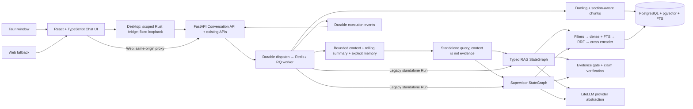
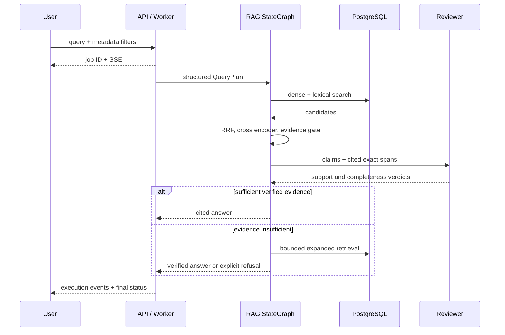
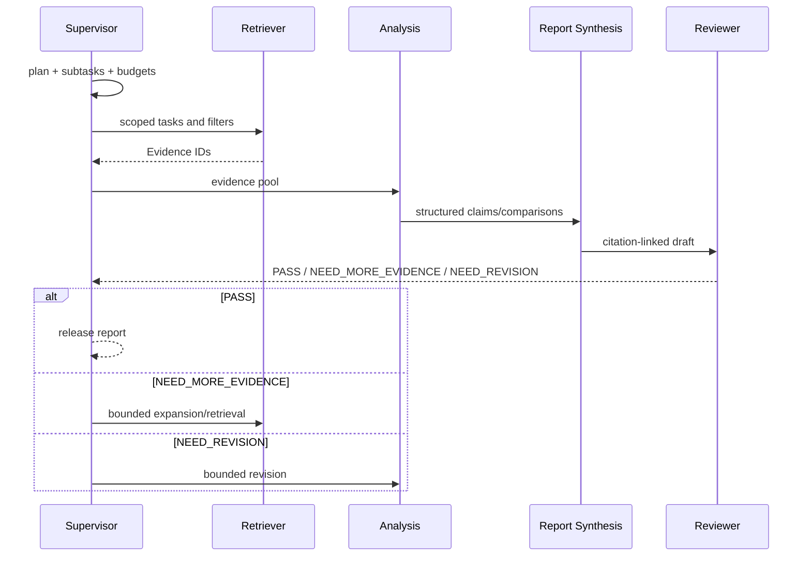

# Scientific RAGAgent

**[English](README.md) | 简体中文**

本地科研文献助手，提供持久化的 RAG/Research 对话、可查看的会话记忆，以及
Tauri 桌面入口。它保留了现有的基于证据的知识库和 Supervisor 工作流。
项目采用 MIT 许可证；论文和模型权重分别受各自许可证约束。
不依赖 langgraph-supervisor，不声称未经验证的基准测试成绩。

默认源码分支为
[`main`](https://github.com/maczhouyi-del/RAGSystem/tree/main)。
此副本保留原始提交历史和 MIT 许可证；
[原仓库](https://github.com/chouytong/RAGAgent)继续保留。
迁移基于原仓库 `fix/engineering-hardening` 分支的 `df75bdd` 提交。
历史 CI 和安装包验证证据仍链接到原仓库中的实际运行记录。

> Windows 免 Docker/WSL 原生部署仍在可行性阶段，当前结论 **NO-GO**：现有 RQ Worker 与中文数据库路径未通过。
> [审计、实际原型结果与后续设计](docs/windows-native/results.md)。下列 beta2 仍要求 Docker，不是新的免依赖安装器。

## 下载、安装与首次使用

从 **[v0.2.0-beta.2 测试版 Release](https://github.com/maczhouyi-del/RAGSystem/releases/tag/v0.2.0-beta.2)** 下载。
应用内部版本 **0.2.0**；此版包含 Windows 图形部署助手和首次模型配置向导。
旧 `v0.2.0-beta.1` 保留原控制台助手。请使用同一 Release 的客户端和部署 ZIP。

**必须同时安装桌面客户端和部署后台。** 桌面安装包不包含整个后台；部署助手通过 Docker 启动
PostgreSQL/pgvector、Redis、API、三个 worker 与 Web。普通用户无需安装 Python、Node.js、Rust 或 Git，
无需编辑 `.env`、执行 Docker Compose 命令或修改 Agent YAML；**Docker 和首次下载所需互联网仍是前置条件**。

### 1. 下载正确的文件

| 电脑平台 | 桌面安装包（同类二选一） | 必须配套的部署包 |
| --- | --- | --- |
| Windows 11 x64（优先） | `.msi` 或安装 `.exe` | `RAGSystem-deployment-windows-x86_64.zip` |
| macOS Apple Silicon | aarch64 `.dmg` | `RAGSystem-deployment-macos-aarch64.zip` |
| macOS Intel | x64 `.dmg` | `RAGSystem-deployment-macos-x86_64.zip` |
| Linux x64（Ubuntu 24.04） | `.deb` 或 `.AppImage` | `RAGSystem-deployment-linux-x86_64.zip` |

打开 Release 的 **Assets**，下载表中两个文件，以及 `SHA256SUMS.txt`、`release-manifest.json`。
公开 Release 安装文件不依赖 GitHub Actions Artifact 的登录与保留期限。
manifest 记录真实构建 SHA、版本、平台、大小和 SHA256；安装器文件名空格替换为下划线，内容不变。
核对下载校验值；Windows PowerShell 可用 `Get-FileHash 文件路径 -Algorithm SHA256`。
`installation-guides.zip` 提供本 README、详细指南、验收说明及第三方许可证的离线副本。

建议 **16 GB 内存、至少 20 GB 空闲磁盘**，模型和论文另需空间。助手最低检查部署盘 5 GiB；
Docker 虚拟磁盘也需要足够空间。首次后台构建通常约 10–30 分钟，实际取决于网络与电脑。
测试版未代码签名/未 macOS notarize：核对来源和校验值，按系统/组织策略处理提示，不关闭系统安全保护。

### 2. Windows 11 安装

1. 按 [Docker 官方 Windows 指南](https://docs.docker.com/desktop/setup/install/windows-install/)
   安装 Docker Desktop，完成必要的管理员操作、WSL2/虚拟化配置和重启。注意 Docker 许可证/订阅条款。
   打开 Docker Desktop，等待运行就绪，使用 **Linux containers**；已有可用 Hyper-V/Linux Docker 无需改用 WSL。
2. 双击 MSI 或安装 EXE 安装 **Scientific RAGAgent**。WebView2 缺失时按安装器/Microsoft 官方引导安装。
3. 解压部署 ZIP，完整保留其中 `RAGSystem` 文件夹，放到长期、个人可写的位置，
   例如 `C:\Users\你的用户名\RAGSystem`。不要放 Program Files、共享盘或临时缓存；不要遗漏隐藏文件。
4. 打开桌面客户端，再双击部署目录的 **`RAGSystem-Setup.exe`**。此版本默认进入五步图形向导。

### 3. 按图形助手完成五步初始化

1. **检查安装条件**：点击检查，按窗口提示处理 Docker 缺失/停止、WSL 未就绪、容器模式、
   Compose 版本、空间或端口问题，再点击同一按钮重新检查。助手不自动安装 Docker或强杀占用端口的程序。
2. **连接本机授权**：在桌面打开 **Connection authorization / 本机授权**，点击复制配对哈希，
   粘贴到助手并保存。复制不可用时手动复制显示的哈希。它不是 API Key；实际桌面凭据存 Windows Credential Manager。
   旧配对可保留，更换需确认。
3. **安全保存密钥**：选择 OpenAI、DeepSeek 或 Anthropic，在遮蔽输入框输入自己的 API Key 并保存。
   保存后输入框清空，只显示是否存在。已有密钥可保留，替换需确认；本地模型/稍后配置可跳过。
   其他 OpenAI 兼容服务在助手选 OpenAI，使用 `OPENAI_API_KEY`。
4. **启动系统**：确认启动可能继续已有排队任务及其费用，点击 **启动 / 恢复系统**。
   助手自动启动数据库/Redis、执行迁移、启动 API、三个 worker 与 Web，等待就绪。
   首次构建耗时较长，保留窗口等待；失败按安全错误码修复后重试，不重置数据。
5. **开始使用**：回桌面点击 **连接并检查授权**，跟随首次使用引导的步骤进度和“下一步”。
   基础服务就绪不等于模型能推理。新安装启动不会自动提交模型测试；已有排队任务可能继续消费此前授权的费用。

以后先打开 Docker，再开助手；已有配置可选 **使用已有配置启动 / 恢复**，不强制重复配对或输入密钥。

### 4. 首次模型配置

1. 在 **Settings → 首次模型配置** 选择服务商、账户实际可用的聊天模型及必要的 API 地址。
   预填名称只是参考，不保证账户权限。API Key 不在此网页/桌面表单中输入。
2. 点击 **为四个角色保存此配置**，确认后为 Supervisor、Retriever、Analyst、Reviewer 生成同一默认模型。
   下方高级设置仍可逐角色修改。保存不改 embedding/reranker 或旧向量索引，不自动覆盖已有角色配置。
3. 如果刚在助手保存密钥，先启动/恢复使容器读入，再点击 **刷新配置与密钥状态**。刷新不发起模型测试。
4. 自行选择 **检查模型连接** 或 **测试模型推理**，阅读费用/发送内容说明，明确确认后才请求服务商。
   目录检查不生成答案；推理检查发送固定指令，不发送论文或会话。失败不自动收费重试；重开页面不自动测试。

| 界面状态 | 实际含义 |
| --- | --- |
| 配置已保存 | 服务端保存了模型与角色映射；不证明账户可用 |
| 密钥存在 | 私有运行时变量存在；不证明密钥有效（本地模型可无需密钥） |
| 连接检查成功 | 模型目录可访问；不证明模型能推理 |
| 模型可实际推理 | 本次固定指令通过；不证明论文答案或科研质量达标 |

部分兼容服务没有目录接口，可主动确认单独推理测试。密钥无效时在原生助手更换并启动生效；
模型无权限时更换模型名称/服务商。四角色不同模型时，在高级设置分别主动测试。
本地 Ollama 需另行安装、加载模型；Docker Desktop 可用 `http://host.docker.internal:11434` 访问宿主，
容器 `localhost` 指向容器自己。Linux 宿主路由需单独配置；不开放模型服务或数据库到公网。

### 5. 第一篇 PDF、RAG、Research 与导出

1. 按“下一步”打开 **Knowledge Base**，导入自己有权使用的 PDF。
2. 查看解析/索引进度，等待 **indexed**。默认本地 embedding/reranker 首次会下载权重；
   网络/空间失败时按下表修复后重试，不清理数据库/模型卷、不混用不同维度的旧索引。
3. 进入 **RAG** 提问，或选择 **Research**；真实模型调用可能收费。检查引用、原文位置和证据，不直接信任结论。
4. 从结果导出报告。重开程序并连接同一本地系统，可以继续查看论文与历史会话。

### 6. macOS、Linux 与 Web

macOS 按 CPU 选择同 Release 的 DMG 和部署 ZIP，按 [Docker 官方 macOS 指南](https://docs.docker.com/desktop/setup/install/mac-install/)
安装并启动 Docker Desktop。Linux x64 安装 deb 或 AppImage，并安装 Docker Engine + Compose ≥2.24（及桌面 WebView/Secret Service 环境）。
按系统/组织策略处理未签名/未 notarize 提示；Linux AppImage 可能需要发行版的 FUSE 兼容支持。

两平台解压部署 ZIP 到个人可写长期目录，在该目录运行 `./RAGSystem-Setup`（随包原生程序，不需要 Python）。
macOS/Linux 保留控制台菜单：**2 配对并启动**，粘贴桌面哈希；**5 隐藏输入密钥**，再 **3 启动**使其生效。
随后使用同一桌面模型向导与 PDF/问答流程。Windows 图形助手的人工体验未据此推断为 macOS/Linux 图形支持。

Web 入口为 `http://127.0.0.1:8080`；通过控制台助手 **9 Web 配对**设置独立凭据，再在 Web 本机授权中输入。
Windows 如需菜单，在部署目录终端运行 `.\RAGSystem-Setup.exe --console`。Web 仍需身份认证，不使用模型 API Key 作配对凭据。

### 7. 常见失败与恢复

| 现象 | 下一步 |
| --- | --- |
| Docker 缺失/停止 | 安装或打开 Docker，等待就绪，重新检查 |
| WSL 未就绪/Windows containers | 按 Docker 官方说明配置虚拟化/WSL及重启，切换 Linux containers |
| 8000/8080 端口冲突 | 关闭自己确认可停止的冲突应用，重新检查；助手不杀进程或自动连接陌生 API |
| 空间不足/下载失败 | 检查部署盘和 Docker 虚拟盘、获准网络/代理；不删除卷、不关闭 TLS 验证 |
| API/数据库/worker 不可用 | 查看 Diagnostics/助手安全错误码，修复 Docker 服务后启动/恢复；保留原数据 |
| 密钥被拒绝/模型不可用 | 原生助手替换密钥并启动，或在 Settings 修改模型；刷新后主动确认测试 |
| 本地模型或 PDF 索引失败 | 检查模型来源、缓存权限、空间及 PDF 损坏/加密；扫描件可能需 OCR/版面模型 |

问题报告只提供版本、构建 SHA、安全错误码及脱敏现象；不上传 API Key、私有 env、完整 Docker/provider 日志或论文正文。
详细说明见[故障排查](docs/installation/troubleshooting.md)。

### 8. 关闭、数据位置、备份、升级与卸载

关闭桌面不会停止后台；图形助手点击 **停止系统**，或控制台菜单 **4 停止**，数据保留。
论文/向量/会话/配置/队列/模型缓存在 Docker 的五类 named volumes；桌面凭据在系统密钥库，
`.env`、`.runtime-secrets.env` 在原部署目录，API Key 只保存在私有 runtime，不能放前端存储/报告/备份。

- **备份**：等待所有导入/问答/Research 完成，控制台菜单 **6 备份**，保留完整 manifest。
  备份含数据库/PDF/非敏感配置，不含密钥、队列及模型权重；保护备份中的科研资料。
- **升级**：先备份，新 ZIP 先解压到临时目录并核对，更新原部署目录的程序文件，
  保留 `.env`、`.runtime-secrets.env`、项目名和五个数据卷；菜单 **7 升级**备份成功后才构建/迁移。
  失败保留数据，不自动降级数据库；数据库主版本升级需单独设计。
- **卸载**：卸载客户端只移除客户端；菜单 **8 卸载容器**需明确 `KEEP DATA`，保留所有卷与私有文件。
  从同一项目重装启动可以恢复数据；不使用 Docker Delete volumes/Clean/Purge 修复问题。
- **异机恢复**：仅在独立空环境恢复自己的完整备份，重新配对/输入密钥；不覆盖原环境。
  操作步骤见[数据、备份、升级和卸载](docs/installation/data-and-upgrades.md)。

### 验证范围与下一步

Windows/macOS 双架构/Linux 原生构建与自动化工程验证记录见[安装验收](docs/installation/first-use-evidence.json)。
工程使用 **MOCK 模型**、真实 PostgreSQL/Redis/Docling Native PDF；不替代真实模型和科学效果评测。
**Windows 11/macOS/Linux 人工安装、真实用户模型与权重下载：NOT EXECUTED。科研质量：NOT MEASURED。**
Windows/Linux ARM64、其他 Linux 发行版也未验证；不预设 Research 优于 RAG。
请按 [Windows11 人工检查表](docs/installation/windows-11-checklist.md)本地验收，再用
[已有本地科研评测工具](docs/installation/local-evaluation.md)评审自己的论文与模型。

## 开发者源码部署

以下命令面向具备 Git、Node.js/npm、Rust 与平台 WebView 开发依赖的贡献者。
普通用户使用上面的测试版安装流程。已有运行时 `.env` 必须保留。

```bash
git clone --branch main https://github.com/maczhouyi-del/RAGSystem.git
cd RAGSystem
# 仅首次 checkout；保留已有运行时 .env。
cp .env.example .env
npm --prefix frontend ci
npm --prefix frontend run desktop:dev
# 将 Desktop 的非敏感配对哈希填入 LOCAL_AUTH_TOKEN_HASH。
# 在另一个终端启动 Compose，再回到 Desktop 检查授权。
docker compose up --build
```

开发诊断使用 `./scripts/diagnose.sh`（Linux）或
`powershell -NoProfile -File .\scripts\diagnose.ps1`（Windows）。
详见[环境诊断](docs/environment-diagnostics.md)、[部署说明](docs/deployment.md)和[首次使用引导](docs/first-use.md)。
`/api/health` 检查进程存活；`/api/ready` 检查数据库、Redis 与交互 worker，不代表模型能够实际推理。
API 文档位于 `http://127.0.0.1:8000/docs`，受保护接口需要本机授权。

RAG/Research 会话使用 `interactive` 队列，PDF/arXiv 使用 `ingestion`，评测使用
`evaluation`。Compose 分别启动三个独立 worker；`/api/ready` 检查交互服务所需
数据库、Redis 和交互 worker，`/api/queues` 分别报告三个队列的可用性与待处理数。
扩容及已有作业迁移见[部署文档](docs/deployment.md#dedicated-workload-queues)。

## 架构



技术栈包括 Python 3.11+、Pydantic v2、SQLAlchemy 2、Alembic、当前版本的
LangGraph、LiteLLM、Docling、PostgreSQL/pgvector、Redis/RQ，前端使用
React/TypeScript/Vite；依赖由 uv/npm 锁文件固定，配套 Docker Compose、
pytest/Ruff/mypy 和 GitHub Actions。

## 对话与本地记忆

RAG Chat 和 Research Chat 分别保存会话历史，支持自动标题、重命名、删除、
有序消息、Markdown/代码块、引用和可折叠执行详情。
Research 保留 Supervisor Plan、Agent 执行轨迹、Reviewer Result 和局限说明。
重新加载 Web UI 或重启桌面应用后，会从 PostgreSQL 读取会话与消息；
浏览器 `localStorage` 不是会话存储。URL 片段用于标识当前选中的会话。

界面先读取最近 50 条轻量消息，需要时再加载更早历史。SSE 驱动实时进度，
重连或恢复时增量读取新消息并核对执行中的占位消息。Run、执行轨迹和证据详情
在打开时读取。被重试替代的旧回答保留为审计记录，并退出后续问题的上下文。

每一轮会同时创建消息、现有 Run 和持久化调度意图。
worker 将可发布的助手回答与终态 Run/事件一起保存；SSE 重连会重放已保存的执行事件。
重复提交通过客户端 UUID 识别；重试会创建新的 Run，并保留前一次失败供查看。
同一会话一次只能执行一轮，不同会话之间独立。
取消操作会撤销结果发布权限，并尽力停止队列任务；已发出的服务商调用仍可能完成并产生费用。

追问经过 Context Builder：当前问题、有界的最近消息、确定性的滚动抽取式摘要，
以及用户明确添加的记忆，共同将代词或已命名的候选对象解析成独立问题。
原始问题和上下文化后的问题可在执行详情中查看。
旧内容的摘录可能丢失信息；指代不明确时会明确失败，而不是猜测。
`CONVERSATION_CONTEXT_TOKEN_BUDGET=8192` 使用多语言近似 token 估算及 UTF-8 摘录字节上限来约束
上下文化输入，并非服务商 tokenizer 的计数，也不是整个工作流的预算。
独立问题跳过改写模型；追问只选择相关 Top-K 记忆文本，全部硬过滤条件仍然生效。
带来源的结构化会话意图/实体状态与抽取式摘要一同持久化，重启后可恢复；
Memory 面板可查看，修改记忆后状态失效并重新构建。

**记忆 ≠ 证据。** 消息、摘要和记忆只用于理解意图与指导检索。
两个独立的 Graph 都会重新检索本轮的原文证据，并保留现有的证据准入、
论断验证和引用验证。例如，历史对话中的“数据集 A 有 500 名参与者”，
不能直接支撑下一轮科研回答。
带元数据过滤条件的结构化约束会与当前过滤条件取交集；冲突时会明确失败。
只有自然语言偏好文本，并不构成强制 SQL 过滤条件。
可在会话的 Memory 面板中添加、查看或删除记忆；
系统不会自动建立隐藏用户画像，也不使用外部记忆服务。

Clear Conversation Memory 删除摘要与记忆记录，并保留消息；
保留下来的历史可能在后续对话中重新生成摘要。
Clear Conversation 删除消息、关联的 Run/事件/调度记录和记忆，但保留空会话。
Delete Conversation 删除上述记录以及会话本身。
知识库论文和无关的评测产物会保留。详见
[会话与记忆生命周期](docs/conversation-memory.md)。

## 本地数据与远程推理

使用默认本地 Compose 服务时，PDF/解析文件、向量索引、会话历史、摘要、
结构化记忆和执行历史保存在本地 PostgreSQL 或命名文件系统卷中。
系统没有云端会话数据库或 SaaS 记忆存储。
备份、下载的评测产物和桌面缓存文档属于独立副本，需要分别删除。

远程聊天服务商会收到必要的问题、用于改写的会话上下文，以及用于分析/审查的检索片段；
托管嵌入服务商会收到待索引文本和检索问题。
远程评测裁判会收到回答与证据载荷。
因此，本地持久化**不等于**推理期间所有数据都留在本机。
如需本地推理，请配置本地聊天、嵌入、重排和解析资源；
除非已有缓存，首次模型下载仍需要网络。
API key 仅放在运行时环境变量或 secrets 中。
会话字段会拒绝可识别的凭据模式；不要将密钥粘贴到自由文本中，
因为模式检测无法识别每一种可能的凭据。

## 论文导入与知识库

可上传 PDF，并可选提供标题、作者、年份、会议/期刊；也可导入开放的 arXiv ID。
系统保留原始 PDF、结构化章节、文本/表格/图注、页码、chunk 和嵌入向量。
可在 Knowledge Base 中查看索引状态和元数据。
切分限制在同一章节和元素类型内，目标 token 数和重叠范围可配置。
小数与科学计数法数值保持完整；可识别的 Markdown 表格按行边界切分，
表头/图表说明保留各自来源，而公式与结构未知的表格保持完整，即使超过目标大小。
新导入的 arXiv 论文会在下载前固定官方带版本的 ID。
来源状态初始为 `unknown`；手动标记为撤回或撤稿的论文会被排除在检索之外。
稠密检索与词法检索使用相同的全部元数据过滤条件。
可通过 API 标注 chunk 实体，以支持数据集、方法和指标过滤。

```bash
curl -F 'file=@paper.pdf' -F 'title=Paper title' -F 'authors=Alice;Bob' \
  http://localhost:8000/api/papers/upload
curl -H 'Content-Type: application/json' -d '{"arxiv_id":"2408.09869"}' \
  http://localhost:8000/api/papers/arxiv
```

## RAG 与科研分析

RAG 支持事实查询、方法比较和带约束的检索。
每一个发布的事实论断都具备经过验证的结构化 Evidence ID、精确支持文本，
以及论文、章节、页码和 chunk 定位。
模型自行编写的引用标记会被拒绝；只有确定性的格式化过程生成引用。
Reviewer 还必须确认每一个附带的论断/证据对都得到支持；不相关的引用需要修订。
多查询检索针对原始问题或当前子任务进行重排，在查询扩展期间保留这一目标。
配置的重排阈值会限制两个工作流提供给生成与验证环节的证据。
缺少支持时，会先进行有界扩展，再明确拒答。
检索分数是启发式分值，不是经过校准的模型置信概率。



Research 生成结构化计划和子任务，调用 Retriever 和 Analysis，
然后执行确定性的 Report Synthesis 与 Reviewer。
NEED_MORE_EVIDENCE 返回检索；NEED_REVISION 返回分析。
检索、修订和总迭代预算防止无限循环。草稿始终明确标注。
重试保留已接受证据的有界并集。
重新规划任务时，只有完整任务内容未变的任务才会保留完成状态，即使复用了相同 ID。



```bash
curl -H 'Content-Type: application/json' -d '{"mode":"rag"}' \
  http://localhost:8000/api/conversations
# Replace CONVERSATION_ID and use a new client UUID for each new logical turn.
curl -H 'Content-Type: application/json' \
  -d '{"content":"Which datasets are used?","client_request_id":"00000000-0000-4000-8000-000000000001"}' \
  http://localhost:8000/api/conversations/CONVERSATION_ID/messages
# Existing single-run API clients remain supported:
curl -H 'Content-Type: application/json' \
  -d '{"query":"How do the papers compare training methods?","filters":{"year_start":2023}}' \
  http://localhost:8000/api/rag/query
curl -H 'Content-Type: application/json' \
  -d '{"research_question":"Compare methods, datasets and metrics for scientific retrieval."}' \
  http://localhost:8000/api/research
curl -N http://localhost:8000/api/research/RUN_ID/events
```

## 服务商与本地模型

编辑 `.env` 中的运行时密钥、`config/agents.yaml`，或通过 Settings UI 设置非密钥映射。
每个 Agent 都可通过 LiteLLM 独立使用 OpenAI、Anthropic、DeepSeek、Ollama，
或兼容 OpenAI 的本地服务。嵌入与重排有各自的配置。
YAML 只在模型字段中展开不含密钥的 `*_MODEL` 变量；
API 映射写入会拒绝未解析的模板。
本地 Host 校验和浏览器同源写入检查保护本地 API。
服务商连通性测试不会返回密钥。
默认聊天映射使用带日期的模型标识；如果服务商返回实际模型身份，也会记录。
托管嵌入支持 `openai`、`cohere`、`cohere_chat` 和 `voyage` 前缀；
兼容服务使用 `openai/<model>`，并显式设置 base 地址。
嵌入端点身份会同时固定用于索引和 SDK 调用。
托管服务的 `EMBEDDING_REVISION` 是运维人员指定的索引标签，并不固定服务端模型权重。
本地 Hub 适配器首次使用时，会将请求的 revision 解析为不可变 SHA；
要复现后续运行，请显式设置该 SHA。
`local:v2` 指纹要求重新嵌入旧的本地索引。
`python -m ragagent.reindex --all-indexed` 会按论文原子更新向量，同时保留 chunk/引用 ID。
全部本地/托管嵌入示例、模型缓存、迁移、网络要求和故障排查见
[部署文档](docs/deployment.md)。

## 评测与开发

Evaluation 页面接受带标注的数据集并运行检索消融评测。
API 和页面也支持 RAG、多 Agent 和会话评测。
会话评测使用生产环境的 Context Builder 和独立 Graph 流水线，
衡量上下文解析、证据支撑、记忆隔离和长摘要案例；不会用记忆替代检索。
每次运行写出 results.json/results.md，记录 Git commit、数据集哈希、时间戳、
执行配置，以及实际的逐查询指标与延迟。
每个案例都会保存结果检查点；部分完成或失败的终态运行仍保留可下载产物，
在数据集、来源、配置和语料身份匹配时，可通过 `resume_run_id` 显式续跑。
续跑费用分别保留当前尝试和先前尝试的记录。
生成评测还会保留最终输出、证据和原始裁判响应，以便检查。
语义裁判结果明确标记为 MODEL_BASED；未知的服务商收费会使总费用不完整。
工作流用量包含托管嵌入；进行中或失败的付费调用会记录为费用未知，而不是假定免费。
worker Run 持久化付费调用用量更新；评测产物也会在案例之间保存这些更新的检查点。
同步检索/服务商测试只返回当前请求用量，重建索引 CLI 打印累计用量；
两者都没有持久化的 Run 计费台账。

```bash
python scripts/annotation_template.py my-annotations.json --count 100
uv sync
uv run ruff format . && uv run ruff check . && uv run mypy src
uv run pytest -q
npm --prefix frontend ci
npm --prefix frontend run lint
npm --prefix frontend run check
npm --prefix frontend run build
npm --prefix frontend exec -- playwright install chromium
npm --prefix frontend run test:e2e
npm --prefix frontend run test:transport
npm --prefix frontend run desktop:check
npm --prefix frontend run desktop:test
npm --prefix frontend run desktop:build
```

仓库中**没有 100 条人工标注样例**。未标注的 100 行模板必须由人工填写。
可选合成语料/数据明确标记为
**DEMO ONLY / NOT A BENCHMARK / NOT MANUALLY ANNOTATED**
（仅供演示 / 不是基准测试 / 未经人工标注）。不声称任何提升数值。
指标定义和局限见 [评测文档](docs/evaluation.md)。
核心测试不需要付费 API 或模型下载；PostgreSQL/pgvector 集成测试在 CI 中运行。
`scripts/smoke.py` 通过前端代理测试全新的空 Compose 部署，
包括真正缺少密钥时的 worker 失败与终态 SSE；它不测试成功推理。
[阶段日志](docs/stage-log.md) 记录实际验证结果。

## 文档与局限

[实现/验收基线](docs/MASTER_SPEC.md) ·
[产品升级交付说明](docs/product-upgrade-report.md) ·
[修复决策](docs/adr/README.md) ·
[参考项目/许可证审查](docs/reference-review.md) · [架构](docs/architecture.md) ·
[数据模型](docs/data-model.md) · [会话与记忆](docs/conversation-memory.md) · [检索](docs/retrieval.md) ·
[Agent](docs/agents.md) · [API](docs/api.md) · [部署](docs/deployment.md) ·
[贡献者规则](AGENTS.md)。

V1 是面向可信本地环境的单用户应用。
英文 PostgreSQL FTS、精确向量检索和词法 token 计数，是首个版本的有意选择。
Docling 的公式、OCR 和表格保真度取决于具体文档与模型。
语义验证可能出错，科研结论需要人工复核。
服务商能力、延迟和模型费用各不相同。
Graph 检查点自动续跑、公共/多租户安全与 ANN 调优仍需要进一步工作。
模型和 PDF 不随仓库分发。
受限云端网络或模型访问会明确列为验证局限，绝不会用模拟推理掩盖。
桌面打包、签名和 GUI 行为取决于平台；
使用脚本化服务商的测试验证的是接口约定，而不是真实模型的多轮对话质量。
当前 checkout 的实际升级检查和剩余验证缺口记录在阶段日志中，
不会因为存在构建命令就推断检查已经通过。

基线和 ADR 是工程修复期间编写的文档，
不是恢复的历史规格或此前的验收证据。
阶段日志区分了实际完成的检查，
与仍未验证的真实 PDF、模型、服务商和基准测试验证。

多语言模型采用仍未验证：[真实模型矩阵](docs/benchmarks/multilingual.md) 将现有模型、候选模型与翻译变体的指标标为 **Not measured**，需提供经审查的人工金标与已核验许可/版本的权重才能实测。CI 的脚本化 provider 不证明检索质量，默认配置保持不变。

本机授权与 Web 开发临时凭据见 [部署说明](docs/deployment.md#local-owner-authentication)。原生凭据保存在系统凭据库，JS 只读取配对哈希；受保护的 API、SSE 与文献读取均需授权。

Windows MSI/NSIS 制品由 [Desktop 工作流](.github/workflows/desktop.yml) 构建；仅使用成功运行的制品并核对哈希。见 [Windows 安装与限制](docs/deployment.md#windows-installers-and-build-provenance)。构建未签名，Windows 11 人工验收需单独完成。

回答完成状态为 **已通过自动证据校验**：引用与模型支持检查不保证科学事实正确。
逐结论支持片段使用经过范围检查的原文字符位置；无法验证时保留完整原文。
PDF 面板明确目标页，系统查看器可能需要手动跳页。Settings 的“本机诊断与版本”
分别显示授权、数据库、Redis、各任务队列与构建来源；模型加载和推理需真实任务验证。
实际测试证据与尚未验证的验收项见 [工程整改报告](ENGINEERING_REVIEW.md)。

历史工程基线提交 `f803d824` 的 backend/frontend/Compose 与 Linux/Windows Desktop CI 均已通过。真实未签名 MSI/NSIS 制品及下载后独立核对的 SHA-256 见[工程报告](ENGINEERING_REVIEW.md#final-implementation-ci-and-inspected-windows-artifacts)。多语言真实质量与 Windows 11 人工验收仍未验证。
