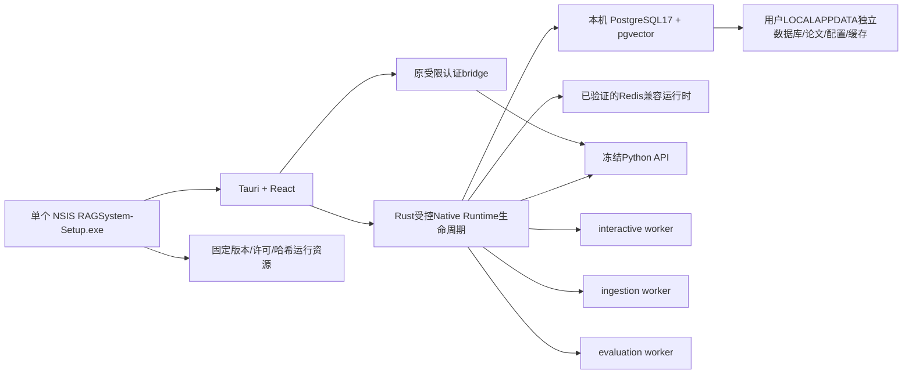

# Windows Native Desktop Runtime：审计与第一阶段门禁

审计基线：`376b73e8fb7ed1b90bec5bbadb80fe7e52f92dd4`，即已交付 beta2 后的验收记录提交。
新分支 `codex/windows-native-runtime` 从该基线开始，原 PR#3/Release/Docker用户数据保留；不修改或合并main。
本次用户明确要求独立分支，覆盖之前安装体验任务“不需要创建新分支”的范围。

状态：**可行性验证 IN_PROGRESS**。静态审查不是GO，下面的问题必须取得原生Windows证据后才处理。
当前beta2仍需要Docker，不是免Docker产品；本阶段不发布或虚构新的RAGSystem-Setup安装器。

## 当前依赖与数据边界

| 层 | 实际实现与原生约束 |
| --- | --- |
| 桌面 | Tauri2/React，固定127.0.0.1:8000 Rust bridge；capabilities只允许allow-local-api；OS凭据库保管bearer。main.rs只创建窗口/桥接，未启动DB/API/worker |
| 安装 | Desktop CI用Tauri MSI/NSIS构建客户端；PyInstaller6.16助手只包装scripts/local_deploy.py/Tk；package_deployment.py白名单另发ZIP，artifact_manifest/verify_installers校验真实文件。不是完整后端打包 |
| 数据库 | Compose `pgvector/pgvector:0.8.2-pg17`；SQLAlchemy/psycopg、Alembic0001～0013，vector+pg_trgm扩展、TSVECTOR/generated FTS、向量距离、row locks/SKIP LOCKED、跨表事务与唯一约束。不能以SQLite替代 |
| 队列 | redis7.4.2 AOF，locked rq2.12.0/redis客户端；interactive/ingestion/evaluation三个进程，legacy路径保留；DB Run为持久调度意图，Redis为RQ消费状态，dispatch/reconcile必须共同正确 |
| 队列语义 | RQQueue使用unique=True、Lua原子入队、LMOVE/BLMOVE、中间队列、Job状态、on_failure/on_stopped、pubsub stop；worker killed callback补充DB失败状态。取消/超时/双重claim不可简化 |
| Python | Python>=3.11,<3.14，locked FastAPI0.142.2/LangGraph1.2.12/LiteLLM1.103.2/RQ2.12.0等；解析可选Docling2.133.0，本地模型可选Torch2.8/torchvision0.23/sentence-transformers5 |
| PDF与模型 | Docling原生文本/复杂版面路径、embedding/reranker协议都必须保留。冻结二进制还需Docling/native wheels/模型缓存/资源/动态导入检验；基础Python打包通过不代表这些已通过 |
| Compose | PG、Redis、migrate、API、三worker、Web；API/Web仅本机8000/8080，DB/Redis无主机映射。postgres/papers/config/redis/models五卷，worker依赖migrate/redis健康检查 |
| 数据与升级 | helper private runtime文件/Windows ACL、OS vault，pg_dump17/PDF/config备份，active_jobs拒绝停写升级，恢复仅独立空项目，KEEP DATA卸载不删卷；原卷/私有env/角色映射不自动迁移 |

涉及现有文件：frontend/src-tauri/{src/main.rs,src/bridge.rs,src/auth.rs,capabilities/main.json,tauri.conf.json}、
scripts/{local_deploy,setup_gui,package_deployment,artifact_manifest,verify_installers,deployment_data}.py、
compose.yaml、docker/backend.Dockerfile、src/ragagent/{worker,jobs,queues,runtime,settings}.py、api/queue.py、
db/{models,session}.py、migrations/versions、ingestion/parser.py、providers/environment.py。

## 两个核心难点及原型计划

### PostgreSQL17 + pgvector0.8.2

使用Windows CI镜像的PostgreSQL17开发分发作为**原型来源**，复制bin/lib/share/include至独立私有测试目录；
从官方pgvector commit `cab9da72c04353f143bb06b42ab70a403daac64a`（v0.8.2）以MSVC/nmake构建并安装到该副本。
以新随机凭据/pwfile、独立临时PGDATA、回环动态端口运行initdb/pg_ctl，不连接或改写已有数据库/系统服务。
执行真实扩展/向量+FTS+pg_trgm、现有Alembic迁移、锁/持久化/异常中断恢复、dump/空库restore检查。
记录版本、必要EXE/DLL/SQL文件哈希，不把预装开发CI当成干净Windows11安装。

PostgreSQL/pgvector均为PostgreSQL宽松许可证。可分发的官方PG二进制来源、VC runtime/OpenSSL/ICU等依赖、
最小用户权限、全新无开发工具环境和用户升级仍必须单独确认；CI预装副本不是已经合法完备的产品安装资源。

### Windows原生Redis兼容方案 + 原版RQ

候选Microsoft Garnet，官方2.2.1 win-x64 ready-to-run ZIP，GitHub资产SHA256固定校验，MIT源码许可证；
存在AUTH、Lua、WATCH/MULTI/EXEC、BLMOVE、pubsub、AOF/checkpoint等源码接口，但声明不能代替语义测试。
以受限私有配置文件/loopback、真实socket/native进程运行，测试Redis客户端及RQ入队/去重/取消/队列隔离/持久恢复。
`.NET`运行时及Lua/native DLL是需核查的额外依赖，不能声称ZIP完全自包含。旧Windows Redis5不作为默认替代：
维护/安全与RQ所需BLMOVE（Redis6.2+）均存在问题；商业兼容服务也不视为可随MIT软件免费重分发。

发现原版RQ2.12.0的Windows障碍：当前worker选Worker（fork）；SpawnWorker虽有spawn接口，实际源码还包含
`os.setpgrp()`及继承的Unix监控/信号假设，子进程以`sys.executable -c`启动，不适用于直接冻结EXE；
`redis_kwargs`插入子进程命令字符串，启用密码时会把Redis密码写入命令行，违反本任务安全边界。
**不执行会携带密码的SpawnWorker命令，也不选择SimpleWorker冒充原有并发/取消/超时能力。**
原型将用真实原版Worker验证实际失败，并记录SpawnWorker源码限制；没有验证过的Windows workhorse适配器前，不能GO。

## 参考项目实际源码与许可

所有固定commit、实际文件SHA256/永久源码链接在[reference-sources.json](reference-sources.json)。
外部源码只读保存在云工作区审查目录，未复制进本MIT仓库，不执行其安装脚本。

| 项目 | 已读取源码及可以借鉴的设计 | 限制/许可 |
| --- | --- | --- |
| WeChatDataAnalysis | desktop/scripts/build-backend.cjs：PyInstalleronefile收集后端依赖/资源；desktop/package.json：Electron安装设置；installer-custom.nsh：用户目录/安装路径防护及异常Abort；backend-startup.cjs：启动与存活状态区分 | 未找到项目根许可证，不直接复制。部分卸载分支含APPDATA递归清理，不采用；不换Electron |
| AnythingLLM | OnboardingFlow/index.jsx、Steps/LLMPreference/index.jsx：先provider/model再完成状态；server/models/systemSettings.js：持久设置与初始化 | MIT。所给公开仓库中未发现桌面主进程/安装器源码，不能据桌面宣传宣称已核验其后台打包；不复制密钥存储方式 |
| Jan | src-tauri/tauri.conf.json、WindowsNSIS模板：资源/安装路径；llamacpp-extension/index.ts：后台worker串行启动/探活/重启/关闭 | 实际LICENSE为Apache2.0（API元数据NOASSERTION）；只借鉴设计，不引入额外通用shell/工具权限，不照搬后台kill流程 |
| Paperlib | electron-builder.win.json5、preference-service.ts、local-backend.ts：安装体验、用户设置/文献根目录与程序目录分离 | GPL3，仅设计比较，不复制实现；其数据库方案不能证明本项目PG/RQ兼容 |
| GPT4All | chat/CMakeLists、installer_control.qs：原生组件安装；download.cpp：临时文件/下载完成校验；localdocs.cpp：索引异步线程/持久目录 | MIT。模型下载校验算法需按本项目SHA256策略选择；其SQLite/Qt路径不替换本项目PG/Tauri |

## 通过门禁后才实施的目标方案

这是候选图，不是已实现功能。程序和签名资源只读；用户数据独立LOCALAPPDATA，身份随机/OS vault，
秘密由私有文件或环境传入，不能放进命令参数。锁定实例、Job Object/受控子进程、限次恢复和明确健康状态必须实测。
端口冲突不能接管陌生服务；保留现有8000桥接可作为首版安全限制，不能静默换端口/扩权。
新API/Worker应共用原业务模块；需单独的冻结入口/资源manifest/runtime模式、Windows worker适配层（若可验证）、
Tauri最小命令/退出控制、NSIS资源挂载、原生私有密钥向导和独立备份。未验证前不修改这些生产模块。

## 第一阶段GO/NO-GO规则

- 原生PG/扩展/现有迁移和真实队列持久/并发/取消/超时/恢复语义及秘密安全均需证据；任一核心门禁不通过，停止生产实施。
- Redis命令成功不能代替RQ workhorse成功；Python脚本成功不能代替冻结后端/Windows11安装。
- NO-GO时交付可复现原型、实际失败/未执行矩阵、文件/许可来源和有边界的后续设计；不偷回Docker、不替换生产队列、不降证据标准。
- 人工干净Windows11、真实模型/论文/科学质量/休眠/安装中断/完整升级尚未执行，全部NOT EXECUTED/NOT MEASURED。
